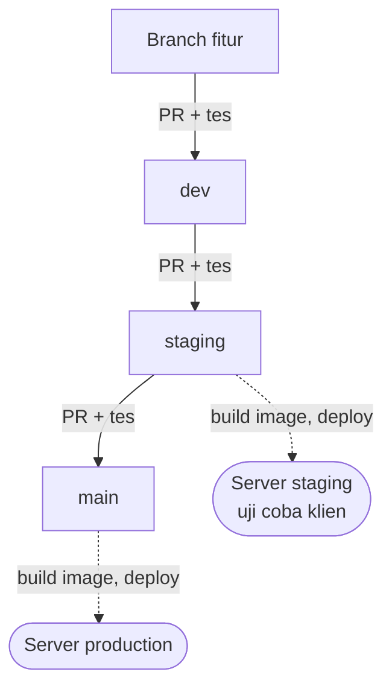

<h2>PT Webekspres Teknologi Indonesia</h2>

<b>Your Digital Partner</b> — website, aplikasi, perangkat lunak, dan pemasaran digital 
untuk UMKM, perusahaan, institusi pendidikan, dan instansi di Indonesia.

  
  
  

  
  
  

  <a href="#tentang-kami">Tentang</a> ·
  <a href="#layanan">Layanan</a> ·
  <a href="#portofolio-pilihan">Portofolio</a> ·
  <a href="#teknologi">Teknologi</a> ·
  <a href="#cara-kami-merilis-perangkat-lunak">Cara Kami Merilis</a> ·
  <a href="#repositori-publik">Repositori Publik</a> ·
  <a href="#hubungi-kami">Kontak</a>

---

## Tentang Kami

**PT Webekspres Teknologi Indonesia**, dikenal sebagai **Webekspres**, adalah mitra layanan digital yang membantu
bisnis tumbuh lewat website, aplikasi, perangkat lunak, dan pemasaran digital. Kami fokus pada desain yang rapi,
performa yang cepat, dan hasil yang nyata bagi klien.

Kami juga mendampingi UMKM dan perusahaan kecil secara menyeluruh: klien tidak perlu memikirkan domain, server,
maupun desain website, karena semuanya kami urus.

<table>
<tr>
<td align="center" width="25%"><h3>2+</h3>tahun pengalaman</td>
<td align="center" width="25%"><h3>120+</h3>klien</td>
<td align="center" width="25%"><h3>60+</h3>website dibangun</td>
<td align="center" width="25%"><h3>10+</h3>anggota tim</td>
</tr>
</table>

Angka dari halaman <a href="https://webekspres.co.id/about/">About</a> di situs resmi. Nomor Induk Berusaha (NIB): 0310240053735.

### Visi

Menjadi mitra digital tepercaya bagi UMKM dan institusi di Indonesia, khususnya di daerah, dalam membangun
kehadiran online yang profesional, efisien, dan berdampak.

### Misi

- Menyediakan jasa pembuatan website dan aplikasi yang cepat, mudah, dan terjangkau.
- Mendukung pertumbuhan bisnis lokal lewat solusi digital yang efektif dan ramah pengguna.
- Menghadirkan desain modern yang sesuai kebutuhan klien.
- Memberi dukungan dan edukasi agar klien bisa mengelola platformnya sendiri.
- Terus berinovasi mengikuti perkembangan teknologi untuk menjaga kualitas layanan.

## Layanan

<table>
<tr>
<td width="50%" valign="top">

### Website Development

- Company profile & landing page
- Toko online (e-commerce)
- Portal berita dan informasi
- Website sekolah, pesantren, dan instansi
- Plugin & tema WordPress

</td>
<td width="50%" valign="top">

### Application Development

- Aplikasi mobile Android & iOS (Flutter, React Native)
- Progressive Web App
- Aplikasi pemesanan, rental, dan delivery
- Aplikasi membership dan loyalitas pelanggan

</td>
</tr>
<tr>
<td width="50%" valign="top">

### Software Development

- Sistem informasi bisnis dan ERP
- Point of Sale, stok, dan akuntansi
- Panel admin dan dashboard operasional
- REST API dan integrasi layanan pihak ketiga
- Otomasi alur kerja dan integrasi AI

</td>
<td width="50%" valign="top">

### Digital Marketing

- Strategi pemasaran digital yang berdampak nyata
- Penguatan kehadiran online bisnis
- Konsultasi awal gratis

</td>
</tr>
</table>

## Kenapa Webekspres

| Dukungan penuh | Kualitas | Ide baru | Pemantauan |
|:---:|:---:|:---:|:---:|
| Pendampingan dan konsultasi berkelanjutan setelah proyek selesai | Standar kualitas tinggi di setiap rilis | Pendekatan yang inovatif untuk tiap kebutuhan | Pemantauan menyeluruh atas sistem yang kami kelola |

## Portofolio Pilihan

| Proyek | Klien | Ringkasan |
|---|---|---|
| Website dealer mobil | PT. Central Mekar Abyudaya | Situs resmi dealer Chery Indonesia dengan katalog, harga, dan pemesanan online |
| Website konstruksi & arsitektur | Kakumagumi Corporation | Profil perusahaan konstruksi dan arsitektur beserta proyek dan layanan utamanya |
| Website tur & perjalanan | PT. Mosaik Karya Amanah | Pemesanan tur, tiket, dan paket wisata dalam satu platform |
| Website pemasok industri | Nexxo Prima Indonesia | Katalog produk dan layanan pemasok industri dan infrastruktur |

Portofolio lengkap: [webekspres.id/portofolio](https://webekspres.id/portofolio/).

## Teknologi

<table>
<tr>
<th align="left">Bahasa</th>
<td></td>
<td>PHP, JavaScript, TypeScript, Python, Dart, Go</td>
</tr>
<tr>
<th align="left">Web</th>
<td></td>
<td>Laravel, Next.js, React, Vue, Django, WordPress</td>
</tr>
<tr>
<th align="left">Mobile</th>
<td></td>
<td>Flutter, React Native</td>
</tr>
<tr>
<th align="left">Runtime & API</th>
<td></td>
<td>Node.js, Bun, Elysia</td>
</tr>
<tr>
<th align="left">Data</th>
<td></td>
<td>MySQL, PostgreSQL, MongoDB, Supabase</td>
</tr>
<tr>
<th align="left">DevOps</th>
<td></td>
<td>Docker, Nginx, Linux, GitHub Actions, Vercel</td>
</tr>
</table>

## Cara Kami Merilis Perangkat Lunak

Setiap perubahan masuk lewat pull request dan diuji otomatis sebelum sampai ke klien.

| Tahap | Yang terjadi |
|---|---|
| `dev` | Integrasi harian tim: lint, typecheck, dan unit test di setiap PR |
| `staging` | Seluruh tes berjalan, image Docker dibangun, lalu dipasang di server staging untuk diuji klien |
| `main` | Versi yang disetujui dibangun ulang dan dipasang ke production |

Workflow dan action yang menjalankan alur ini terbuka untuk umum di repo
[`.github`](https://github.com/Webekspres/.github).

## Repositori Publik

| Repositori | Isi |
|---|---|
| [`.github`](https://github.com/Webekspres/.github) | Profil ini, file default komunitas, template workflow, reusable workflow `build-image` & `deploy-ssh`, action `tunggu-db` |
| [`ci-images`](https://github.com/Webekspres/ci-images) | Image Docker untuk CI (`ci-php`, `ci-node`, `ci-python`, `ci-flutter`), dibangun ulang tiap bulan dengan patch keamanan |

Kode proyek klien disimpan di repositori privat.

## Panduan untuk Kontributor

| Dokumen | Isi |
|---|---|
| [Panduan Kontribusi](https://github.com/Webekspres/.github/blob/main/CONTRIBUTING.md) | Alur kerja Git, standar kode, dan proses PR |
| [Kode Etik](https://github.com/Webekspres/.github/blob/main/CODE_OF_CONDUCT.md) | Prinsip kolaborasi dan perilaku yang diharapkan |
| [Kebijakan Keamanan](https://github.com/Webekspres/.github/blob/main/SECURITY.md) | Cara melaporkan kerentanan secara bertanggung jawab |
| [Dukungan](https://github.com/Webekspres/.github/blob/main/SUPPORT.md) | Kanal bantuan dan waktu respons |

> [!TIP]
> Menemukan celah keamanan di salah satu produk kami? Jangan buka issue publik. Ikuti langkah di
> [Kebijakan Keamanan](https://github.com/Webekspres/.github/blob/main/SECURITY.md).

## Hubungi Kami

| | |
|---|---|
| Alamat | Jl. Raya Proklamasi Gg. Adimix, Perumahan Bumi Indah Proklamasi Blok F1 No. 12A, Tunggakjati, Karawang Barat, Karawang, Jawa Barat 41311 ([peta](https://maps.app.goo.gl/Suq2KmcC4iFnZfo98)) |
| Telepon / WhatsApp | [0859 7482 9122](https://wa.me/6285974829122) · 0851 1739 1788 |
| Email | [info@webekspres.co.id](mailto:info@webekspres.co.id) |
| Situs | [webekspres.co.id](https://webekspres.co.id) (profil perusahaan) · [webekspres.id](https://webekspres.id) (layanan & pemesanan) |

Konsultasi awal **gratis**. Ceritakan kebutuhan Anda lewat [WhatsApp](https://wa.me/6285974829122)
atau [email](mailto:info@webekspres.co.id).

<a href="#">Kembali ke atas</a>

